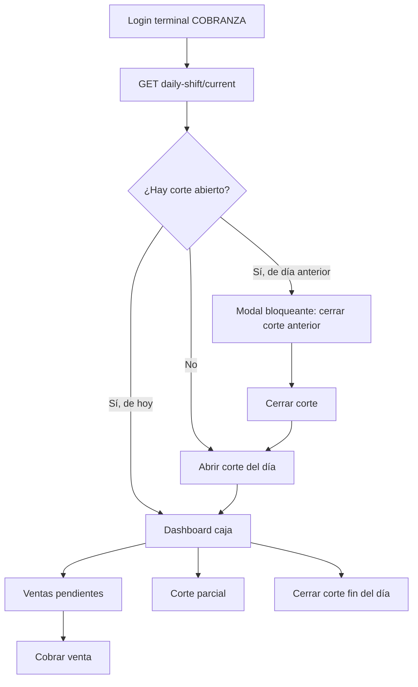
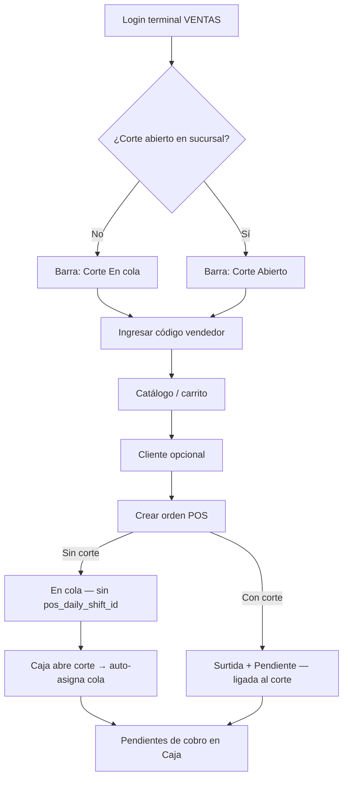
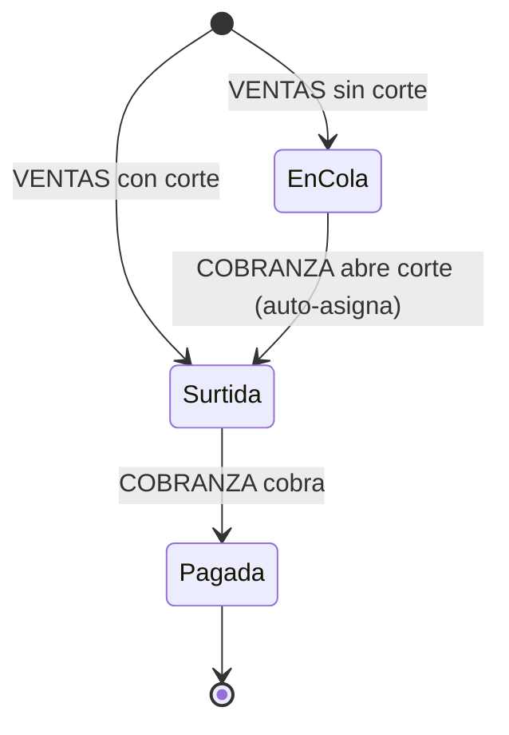
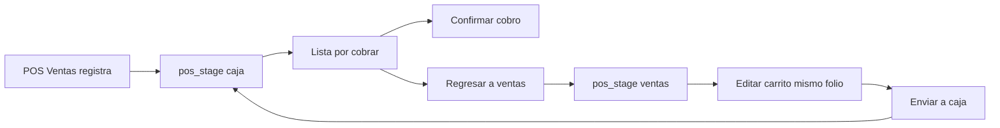
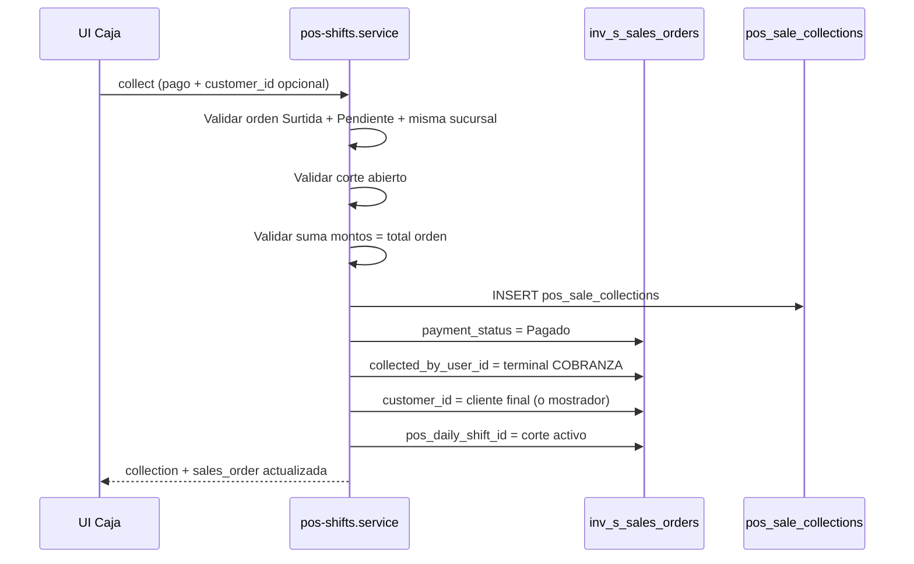

# Flujo POS — Guía para UI

**2026-11-25 — Cartas sueltas en caja.** El buscador se queda en su caja. Las órdenes van directo sobre el fondo, y el cobro también: cada bloque es su propia carta.

**2026-11-25 — Reimprimir en cobradas.** En Órdenes cobradas cada carta tiene Ticket y Factura. Abren el mismo diálogo del cobro: el ticket siempre, y la factura al lado cuando existe. Cliente y empresa van a una línea, así todas las cartas miden igual.

**2026-11-25 — Cobro e impresión.** En caja, efectivo y dólares van lado a lado cuando se elige Ambas, y los métodos de pago quedan en una sola fila. Al cobrar siempre está el ticket. Si hay factura, el ticket y el PDF se ven juntos y el PDF usa casi toda la pantalla.

**2026-11-25 — Caja compacta.** En Ventas el folio del carrito es una barra: tipo, folio, anticipo y saldo a favor o por cobrar. En Caja el cobro abre con Volver, folio y fecha (3 nov 26). El cliente elegido se reduce a una barra con Editar. Falta y cambio van en una tabla MXN / USD. Los recibos filtran Todos, Solo anticipos y Solo ventas, y el vendedor sale de las cartas cargadas. Cada recibo puede regresarse a ventas.

**2026-11-25 — Anticipo en caja.** La cotización con anticipo llega a POS Caja para cobrarse en el corte abierto. La carta de anticipo se distingue de la de venta. En el caso con productos se cobra el anticipo de la cotización; la diferencia y la factura final quedan en la venta. El timbrado abre en demo. Quien puede ver POS puede regresar el folio a ventas.

**2026-11-25 — Anticipo en Folios.** Cada cotización muestra Anticipo y si ya tiene venta (folio de la orden, o Sin venta). Al continuar, el carrito usa el precio de cada línea. Arriba del carrito queda una sola línea con el folio, el anticipo, lo que sobra o lo que caja cobra, y los accesos PDF Anticipo, Cotización y Orden. La cabecera del carrito queda a la misma altura que Folios y En caja.

**2026-11-25 — Folios es el anticipo.** En POS Ventas ya no hay botón de Tickets. Folios abre en Anticipos: cotizaciones con anticipo. Al continuar se elige C1, C2 o C3 y arriba del carrito queda el folio, el anticipo cobrado y lo que caja cobra o lo que sobra. Copiar orden es aparte: busca un folio o un cliente y copia la venta. En caja, Información abre la orden a todo lo ancho, con la lista de productos scrolleable.

**2026-11-25 — Caja en vivo.** POS Caja recibe por el canal `GET /pos/caja-recalls` un `arrived` cuando Ventas manda un folio y un `recalled` cuando lo regresa. La lista se actualiza sola, avisa con «Llegó» y pone lo más reciente arriba. Sin una orden elegida no hay panel de cobro: la cuadrícula usa toda la pantalla.

**2026-11-25 — Varias transferencias en pago mixto.** En mixto se pueden capturar dos o más transferencias. Cada una pide monto y referencia. La referencia no se repite en la venta ni en cobros anteriores. Nombre y razón social del ordenante se piden una vez. La venta cierra cuando la suma cubre el total. `transfer_payments` guarda el desglose; `amount_transfer_mxn` sigue siendo la suma.

**2026-11-25 — Folios, búsqueda y pagadas.** En Folios la búsqueda cubre folio, cliente, empresa, RFC, razón social y teléfono. Ventas y Cotizaciones, Con anticipo, y Pagadas (Ocultar o Mostrar) son controles aparte. Las ventas pagadas no salen hasta elegir Mostrar.

**2026-11-25 — Cotizar más compacto.** El diálogo de Cotizar es más ancho. La cabecera queda a la mitad. Cliente y Público en General van en una línea, y los productos en otra. El monto del anticipo es un solo campo.

**2026-11-25 — En caja, Información.** En POS Ventas cada carta de En caja abre con Información, en el mismo lugar, y ahí está Regresar a ventas. Ya no salta a lo ancho ni se queda trabada.

**2026-11-25 — Tickets ya no se abre solo.** En POS Ventas el panel de Tickets no se abre al entrar. El número de la barra sigue siendo las ventas que ya están en ventas. Las que esperan cobro siguen en **En caja**; de ahí se regresan a ventas. La hora de esas cartas usa el reloj de Tijuana: un folio de la 1:41 p. m. ya no se ve como las 9:41 p. m.

**2026-11-24 — folios, tres carritos y abono.** En Ventas y en Caja la barra tiene **Folios**, limitado a la sucursal y la razón social de la sesión. En Ventas la lista mezcla cotizaciones y ventas; **Llevar a carrito** copia las líneas a C1, C2 o C3. Esos carritos guardan solo cliente y productos (sin precio) y al activarlos cobran el precio vigente. En Caja, Folios lista órdenes con saldo y **Abonar** registra el pago en la orden y en el corte abierto. Sin corte abierto no se registra. Ctrl+Q abre ese diálogo. Los anticipos no entran.

**2026-11-24 — carrito un poco más angosto.** En Ventas el panel del carrito baja de 42vw (tope 760px) a 38vw (tope 680px). El descuento global solo aparece en el desglose si hay uno aplicado; si no, queda un enlace para abrirlo. El descuento en precio del desglose usa un título chico y el porcentaje en una pastilla.

**2026-11-24 — carrito más ancho.** En Ventas el panel del carrito ocupa más ancho. El ícono de descuento de precio de cada línea queda a la misma altura que la lista, el descuento del producto y la cantidad.

**2026-11-23 — existencias por sucursal.** En Ventas el cambio de vista sigue (tarjetas, lista) y se agrega la bodega: la misma búsqueda, en una tabla de todas las sucursales, ordenada por cantidad, sin costos. El selector de sucursal no lleva texto encima. Ver `src/api/inventory/docs/UI_POS_BRANCH_STOCK.md`.

**2026-11-23 — sucursal en la barra.** En Ventas y Caja, **Sucursal** muestra solo el nombre (Buenos Aires), sin la ciudad. El modal de cambio sigue con nombre y ciudad. El filtro de existencia del catálogo, cerrado, muestra solo el nombre; al abrirlo la lista sigue con nombre y ciudad.

**2026-11-24 — corte y terminal en la barra POS.** En Ventas y en Caja la barra muestra **Corte abierto** (o cerrado, atrasado, en cola). El nombre de la terminal sale al pasar el cursor. Ya no hay un bloque aparte de Terminal.

**2026-11-23 — impresión al cobrar en POS Caja.** Al confirmar el cobro se abre un modal con el ticket (copias, default 2) y, si se timbró factura, un tab **PDF factura** (copias default 2, editables). Cerrar anima el contador de **Órdenes cobradas**. El anticipo responde `invoice_id` para imprimir ese PDF. La impresora del PDF es distinta de la térmica.

**2026-11-23 — descuento de precio en POS Ventas.** En el carrito, el permiso `POS:ApplyPriceDiscount` muestra un ícono de porcentaje junto a la cantidad. Al pulsarlo salen 5%, 3% y un campo corto para otro porcentaje, del mismo alto que el stepper. Baja el precio de la línea y se guarda en `line_items[].discount_percentage`. No usa `product_discount_id` ni el descuento global. Sin permiso, crear o cambiar ese porcentaje responde 403. Reenviar el mismo porcentaje ya guardado sí se permite. El ticket imprime `DESC. PRECIO 5%` y el total `Desc. en precio`.

**2026-11-23 — avisos de corte y tickets en POS Ventas.** En la pantalla de ventas no hay franjas bajo la barra. El corte y el conteo de tickets regresados viven en la barra superior. El texto del corte sale al pasar el cursor, junto con el nombre de la terminal.

**2026-11-12 — prueba en verdulería.** Sucursal TIJ-1, rol Punto de Venta (mismos permisos que madería). Terminal ventas `ventas.prueba@verduleria.com`, terminal caja `caja.prueba@verduleria.com`, contraseña `123`. En ventas se teclea el código `1001` (Vendedor Prueba, no inicia sesión como terminal). Rodolfo Pruebas sigue como gerente `AMBOS` con código `1425`. Seed: `src/database/seeds/seed-verduleria-pos.ts`.

**2026-11-03 — observaciones al registrar venta.** El modal de **Registrar venta** pide observaciones (opcional). Se guardan en `notes` y el ticket imprime el bloque **OBSERVACIONES**. Si se dejan vacías, se conserva `POS Ventas - {terminal}`. Al reenviar un ticket, `PUT /pos/sales/:id/cart` acepta `notes` (vacío las borra; si se omite, se conservan).

**2026-11-02 — para envío.** Al registrar la venta (y al reenviar un ticket a caja) se puede mandar `for_shipping`. En Caja, cada orden pendiente o cobrada se marca o se quita con `PATCH /tenant/sales-orders/:id/for-shipping`. Ver `src/api/sales-orders/docs/UI_SALES_ORDER_FOR_SHIPPING.md`.

Documento de referencia del nuevo modelo POS. Reemplaza **Equipos** (`pos_configurations`) y **Sesiones** (`pos_sessions`).

**Crédito, mixto por tipos y factura al cobrar:** `src/api/customers/docs/UI_CUSTOMER_CREDIT.md`.

## Resumen del modelo

| Concepto anterior | Concepto nuevo |
|-------------------|----------------|
| Equipo POS | Usuario con `is_pos_user: true` |
| Sesión POS | **Corte global** (`pos_daily_shifts`) — varios por sucursal por día, **uno abierto** a la vez |
| Usuario en sesión | Vendedor identificado por **código numérico** (`pos_user_code`) |
| Retiro de efectivo | **Corte parcial** con desglose de billetes MXN/USD |
| Ventas sin corte abierto | Órdenes en **cola** (`En cola`, sin `pos_daily_shift_id`) hasta que Caja abra el día |

### Tipos de terminal POS (`pos_user_type`)

| Tipo | Rol | Quién |
|------|-----|--------|
| `VENTAS` | Captura pedidos. No cobra ni maneja corte. | Cualquier usuario POS |
| `COBRANZA` | Abre/cierra corte, cortes parciales, cobra ventas pendientes. | Cualquier usuario POS |
| `AMBOS` | Ventas **y** caja. Ve ambas opciones en el menú. | **Solo gerentes** (`is_manager: true`) |

Un POS normal es **Ventas o Caja**, nunca los dos. Si el usuario es gerente y POS, puede ser `AMBOS`.

### Tipos de usuario en el sistema

| Usuario | `is_pos_user` | `pos_user_type` | `pos_user_code` | Sucursal |
|---------|---------------|-----------------|-----------------|----------|
| Terminal Ventas | `true` | `VENTAS` | Opcional (si vende) | Obligatoria |
| Terminal Caja | `true` | `COBRANZA` | Opcional | Obligatoria |
| Gerente POS | `true` | `AMBOS` | Recomendado (para vender) | Obligatoria |
| Vendedor | `false` | `null` | Opcional (único por organización) | Opcional |

### División Ventas vs Caja (regla de oro)

| Acción | Terminal VENTAS | Terminal COBRANZA |
|--------|-----------------|-------------------|
| Catálogo + carrito | Sí | No (solo cobra pendientes) |
| Seleccionar cliente | **Opcional** (preselección para caja) | **Sí** (al cobrar; puede cambiar o completar) |
| Método de pago / efectivo / cambio | **No** | **Sí** |
| Generar factura | **No** | **Sí** (si el cliente tiene datos fiscales) |
| Crear pre-orden (`POST sales-orders`) | Sí | Solo casos excepcionales |
| Cobrar (`POST pos/sales/:id/collect`) | **No** | Sí |

La orden POS es una **pre-orden**: productos + vendedor + total. El cliente se puede preseleccionar en ventas; si se omite, queda mostrador. Caja puede dejarlo, cambiarlo o asignarlo. Pago y factura solo en caja.

---

## Parte 1 — Configuración en backoffice (Gestión de Usuarios)

### Modal usuario — 3 tabs

#### Tab: Información general
Campos habituales (nombre, email, contraseña, etc.). Sin cambios POS aquí.

#### Tab: POS

**Check:** `Usuario de tipo POS` → `is_pos_user`

**Código POS** (`pos_user_code`, ej. `33456`): **siempre visible**, también si el check POS está marcado. Es el número que se teclea en la pantalla de ventas. Un gerente que vende necesita el suyo.

Si **desmarcado** (vendedor normal):
- Ocultar selector Ventas/Caja.

Si **marcado** (terminal):
- Si **no** es gerente: selector **obligatorio** Ventas **o** Caja → `pos_user_type` (`VENTAS` / `COBRANZA`). No puede marcar ambos.
- Si **sí** es gerente (`is_manager`): puede elegir **Ventas y caja** → `pos_user_type: "AMBOS"`. En el menú POS verá las dos apps.
- Texto de ayuda:
  > *Las terminales POS requieren sucursal asignada. **Ventas** solo captura pedidos; **Caja** maneja el corte del día y el cobro. Un **gerente** puede operar ambos. El código es el que se teclea en POS al vender.*

**Bloqueo en edición:** si el usuario es `COBRANZA` y tiene un **corte global abierto**, deshabilitar cambio de tipo POS, check POS y sucursal. El API responde 400 si se intenta cambiar.

#### Tab: Sucursales asignadas

- **Una o más sucursales** (checkboxes) + una **principal**.
- Opción “Sin restricción / Todas” → sin asignaciones (solo usuarios **no POS**).
- Si `is_pos_user === true` → **al menos una** sucursal.
- `billing_branch_id` en sesión = sucursal **activa** (inventario y corte). El usuario con más de una la elige en POS.
- Detalle: `src/api/users/docs/UI_USER_BRANCHES.md`.

**API usuarios:**
- `POST /api/tenant/users`
- `PUT /api/tenant/users/:userId`
- `GET /api/tenant/users` / `GET /api/tenant/users/:userId`

**Campos relevantes en respuesta:**
```json
{
  "is_pos_user": true,
  "pos_user_type": "COBRANZA",
  "pos_user_code": 33456,
  "billing_branch_id": "uuid",
  "billing_branch": { "id", "code", "fiscal_configuration": { "razon_social", "rfc" } },
  "has_all_branches_access": false
}
```

**Badges en lista de usuarios:**
- `POS Ventas` / `POS Caja`
- Código del vendedor si aplica
- Nombre de sucursal

### Pantalla Configuración POS (menú Punto de Venta)

**Eliminar:**
- Tab Equipos y botón “Nuevo Equipo”
- Tab Sesiones
- Cualquier llamada a `/api/tenant/pos-configurations` o `/api/tenant/pos-sessions`

**Reemplazar por tab Cortes:**
- `GET /api/tenant/pos/daily-shifts?terminal_user_id=&billing_branch_id=&shift_date=&status=`
- Detalle: `GET /api/tenant/pos/daily-shift/:id`
- Columnas: fecha, terminal caja, sucursal, estado, ventas totales, # parciales, efectivo inicial

**Sucursales para dropdowns:**
- `GET /api/tenant/billing/branches`

---

## Parte 2 — Autenticación

Cada **terminal** es un usuario normal del ERP con login estándar (JWT).

```
POST /api/auth/login  →  token de la terminal (VENTAS o COBRANZA)
```

El **vendedor** no hace login. Solo ingresa su código en la pantalla POS; el token sigue siendo el de la terminal.

### Respuesta de login (campos POS)

Pollux **no** debe llamar `GET /api/tenant/users/:id` (requiere `User:Read`). Usar el objeto `user` del login:

```json
{
  "access_token": "eyJhbGc...",
  "user": {
    "id": "uuid",
    "email": "cima_cobranza_t1@zonanorte.com",
    "tenant_id": "uuid",
    "status": "active",
    "roles": ["Punto de Venta"],
    "permissions_flat": ["pos:ViewMenu", "pos:read"],
    "permissions_version": 1,
    "is_pos_user": true,
    "pos_user_type": "COBRANZA",
    "pos_can_sell": false,
    "pos_can_collect": true,
    "is_manager": false,
    "billing_branch_id": "uuid-sucursal",
    "fiscal_configuration_id": "uuid-razon-social"
  }
}
```

| Campo | Uso en Pollux |
|-------|----------------|
| `is_pos_user` | `false` → no es terminal POS (no entrar a app POS o mostrar error) |
| `pos_user_type` | `VENTAS` / `COBRANZA` / `AMBOS` |
| `pos_can_sell` | `true` → mostrar menú / app **Ventas** |
| `pos_can_collect` | `true` → mostrar menú / app **Caja** |
| `is_manager` | Si es gerente. `AMBOS` solo es válido con esto en `true` |
| `billing_branch_id` | Sucursal de la terminal (obligatorio si `is_pos_user`) |
| `fiscal_configuration_id` | Razón social de esa sucursal. Usar en `POST sales-orders`. **No** sacarla de `GET /warehouses/:id` ni de Ajustes. |

Si `pos_can_sell && pos_can_collect` (gerente `AMBOS`), mostrar **ambas** opciones en el menú. No rutees a una sola app.

```
if (user.pos_can_collect) → item menú Caja / /pos/cobranza
if (user.pos_can_sell)    → item menú Ventas   / /pos/ventas
```

Los mismos campos POS vienen en `POST /api/auth/refresh`.

### Routing UI tras login (Pollux)

Guardar `user` en sesión (localStorage / state). **No** pedir código de vendedor hasta saber el tipo.

```
if (!user.is_pos_user) → error o redirigir al ERP
if (user.pos_can_collect && user.pos_can_sell) → menú con Ventas y Caja (no forzar una sola ruta)
if (user.pos_can_collect) → /pos/cobranza
if (user.pos_can_sell)    → /pos/ventas
```

| Ruta | Quién | Primera pantalla |
|------|-------|------------------|
| `/pos/cobranza` | `COBRANZA` o `AMBOS` | `GET pos/daily-shift/current` → abrir corte o dashboard pendientes |
| `/pos/ventas` | `VENTAS` o `AMBOS` | Código vendedor → catálogo |

`POST /api/auth/refresh` debe actualizar los mismos campos en sesión si cambian permisos o datos POS del usuario.

---

## Parte 3 — Flujo terminal Caja (`COBRANZA`)



### Paso 1 — Login
Usuario: `POS Caja CIMA` (ejemplo). Token en todas las peticiones.

### Paso 2 — Verificar corte del día
```
GET /api/tenant/pos/daily-shift/current?billing_branch_id={sucursal-seleccionada}
```

El corte que regresa es el de esa sucursal, no el de la sucursal principal del usuario.

Respuesta si hay corte **de hoy**:
```json
{
  "daily_shift": {
    "id": "uuid",
    "shift_date": "2026-08-17",
    "status": "open",
    "is_previous_day": false,
    "opening_cash_mxn": 1500,
    "opening_cash_usd": 0,
    "terminal_user": { ... },
    "billing_branch": { ... },
    "sales_summary": { "total_mxn": 8300, "sales_count": 10 },
    "partial_shifts": [ ... ],
    "totals": { "partial_shifts_count": 1, "removed_total_mxn": 5000, "sales_total_mxn": 8300 }
  },
  "requires_previous_close": false,
  "unclosed_shift_alert": null,
  "usd_exchange_rate": 16.8,
  "usd_exchange_rate_date": "2026-08-16"
}
```

Si `daily_shift: null` → mostrar pantalla **“Abrir corte del día”**.

### Paso 2b — Corte de un día anterior sin cerrar (obligatorio)

El corte debe cerrarse **completo todos los días**. Si quedó abierto de ayer (o antes), no se puede operar el día de hoy hasta cerrarlo.

**Cómo detectarlo:** `requires_previous_close === true` o `unclosed_shift_alert !== null`. No comparar fechas en UI; usar esos campos.

```json
{
  "daily_shift": {
    "id": "uuid",
    "shift_date": "2026-08-15",
    "status": "open",
    "is_previous_day": true,
    "opening_cash_mxn": 1500
  },
  "requires_previous_close": true,
  "unclosed_shift_alert": {
    "active": true,
    "daily_shift_id": "uuid",
    "shift_date": "2026-08-15",
    "today": "2026-08-17",
    "days_open": 2,
    "title": "Corte del día anterior sin cerrar",
    "message": "Quedó un corte abierto del 2026-08-15 sin cerrar. Es necesario cerrarlo para continuar.",
    "severity": "blocking"
  }
}
```

**UI — modal de verificación (bloqueante, no se puede omitir):**

Al entrar a `/pos/cobranza`, si `unclosed_shift_alert` viene con datos, mostrar modal inmediato **antes** del dashboard. No usar el banner azul informativo de “Corte global del día”; este aviso es de alerta.

```
┌──────────────────────────────────────────────────────────┐
│  ⚠  Corte del día anterior sin cerrar                    │
│                                                          │
│  No se cerró el corte de ayer (2026-08-15).              │
│  Es necesario cerrarlo para continuar.                   │
│                                                          │
│  El corte debe cerrarse completo todos los días          │
│  antes de abrir uno nuevo.                               │
│                                                          │
│              [ Ir a cerrar corte ]                       │
└──────────────────────────────────────────────────────────┘
```

| Campo API | Uso UI |
|-----------|--------|
| `unclosed_shift_alert.title` | Título del modal |
| `unclosed_shift_alert.message` | Cuerpo (usar tal cual) |
| `unclosed_shift_alert.shift_date` | Fecha del corte pendiente |
| `unclosed_shift_alert.daily_shift_id` | ID para `PATCH .../close` |
| `unclosed_shift_alert.severity` | Siempre `blocking` → no dismiss, no “continuar de todos modos” |

**Reglas de UI:**

- No hay botón “Más tarde”, X ni overlay click-to-close.
- CTA único: **Ir a cerrar corte** → tab Cortes / flujo de cierre del `daily_shift` actual (el de ayer).
- Mientras el corte atrasado siga abierto, **sí** se puede cobrar pendientes y registrar parciales de **ese** corte (hay que terminarlo). **No** se puede abrir el corte de hoy.
- `POST /pos/daily-shift/open` responde 400: *Hay un corte abierto del YYYY-MM-DD sin cerrar. Ciérralo antes de abrir otro.*
- Tras `PATCH .../close` exitoso, volver a `GET current`. Si `daily_shift: null`, mostrar **Abrir corte del día**.

**UI Ventas (`/pos/ventas`):** mismo payload. Modal bloqueante: caja debe cerrar el corte de ayer. CTA **Entendido**. Las ventas nuevas **no** se ligan a ese corte; van a cola (`queued: true`) hasta que cierren el anterior y abran el de hoy.

**Día calendario:** `shift_date` y “hoy” se calculan en `America/Tijuana`. `DATE(created_at)` no sirve: el servidor está en UTC y desde las 17:00 ya es el día siguiente.

### Paso 3 — Abrir corte global (solo COBRANZA)
```
POST /api/tenant/pos/daily-shift/open
```
```json
{
  "opening_cash_mxn": 1500,
  "opening_cash_usd": 0,
  "notes": "Apertura turno matutino",
  "billing_branch_id": "uuid-sucursal-seleccionada"
}
```

`billing_branch_id` es la sucursal **seleccionada** en POS (la del header). No uses la sucursal principal del usuario si eligió otra. El corte, la cola y el cobro quedan en esa sucursal.

Reglas:
- Varios cortes **completos** (abierto → cerrado) por **sucursal** el mismo día.
- Solo puede haber **un corte abierto** a la vez por sucursal (aunque sea de un día anterior).
- Tras cerrar un corte, se puede abrir otro el mismo día con nuevo efectivo inicial.
- Si quedó un corte abierto de otro día, `GET daily-shift/current` lo devuelve con `unclosed_shift_alert` y `requires_previous_close: true`. La UI **debe** mostrar el modal bloqueante del Paso 2b y cerrarlo antes de abrir uno nuevo.

**Al abrir el corte y al listar pendientes (automático):** el backend asigna al corte solo las órdenes POS de la **misma sucursal y del mismo día del corte** (`DATE(created_at) = shift_date`) que estén en cola o surtidas sin corte y sin cobro. Pasan a `Surtida` + `Pendiente` con `pos_daily_shift_id` de ese corte. Una venta de otro día no entra a este corte.

Respuesta sugerida:
```json
{
  "message": "Corte global abierto correctamente",
  "daily_shift": { "id", "shift_date", "status": "open", ... },
  "queued_sales_assigned": 4
}
```

**UI Caja tras abrir:**
- Toast o banner: *"Corte abierto. Se asignaron 4 órdenes de cola."*
- Si `queued_sales_assigned > 0`: *"Tienes 4 órdenes por cobrar"* en el dashboard (badge en la sección de pendientes).
- Redirigir o destacar la lista `pending-sales` para cobrar de inmediato.

Si no había cola (`queued_sales_assigned: 0`), solo confirmar apertura y mostrar dashboard normal.

### Paso 4 — Dashboard caja (pantallas principales)

| Sección | Endpoint |
|---------|----------|
| Resumen del corte | `GET /api/tenant/pos/daily-shift/current?billing_branch_id=` |
| Ventas por cobrar | `GET /api/tenant/pos/pending-sales` |
| **Ventas cobradas** | `GET /api/tenant/pos/collected-sales` |
| Inventario sucursal | `GET /api/tenant/inventory/pos/summary` |

### Paso 5 — Lista de ventas pendientes
```
GET /api/tenant/pos/pending-sales
```

Devuelve órdenes con:
- `general_status: Surtida`
- `payment_status: Pendiente`
- `sales_order_type: POS`
- **`pos_daily_shift_id` = corte abierto** (misma fuente que `sales_summary.total_mxn` del dashboard)
- `pos_stage` distinto de `ventas` (caja o null). Los tickets reintegrados no aparecen aquí.

Si hay corte abierto, no filtra por almacén: las órdenes ligadas al corte aparecen aunque el `warehouse_id` venga mal del frontend.

```json
{
  "pending_sales": [
    {
      "id": "uuid",
      "folio": "OV-000123",
      "total": 830.50,
      "subtotal": 715.00,
      "created_at": "...",
      "notes": null,
      "walk_in_name": "Juan Pérez",
      "walk_in_rfc": "XAXX010101000",
      "customer": {
        "id": 1,
        "name": "Público en General",
        "is_walk_in": true
      },
      "seller_user": { "id", "first_name", "last_name", "pos_user_code": 33456 },
      "terminal_user": { "id", "first_name", "last_name", "pos_user_type": "VENTAS" }
    }
  ]
}
```

### Paso 6 — Cobrar venta (solo COBRANZA)

**Ventas no captura pago ni factura.** El cliente de la pre-orden es opcional: si Ventas lo eligió, Caja lo ve prellenado y puede dejarlo o cambiarlo. Si no, queda mostrador y Caja puede asignarlo. Todo el cobro ocurre aquí.

```
POST /api/tenant/pos/sales/:salesOrderId/collect
```

#### Ejemplo — efectivo MXN
```json
{
  "payment_method": "cash",
  "amount_cash_mxn": 830.50,
  "received_cash_mxn": 1000,
  "customer_id": 42
}
```

#### Ejemplo — efectivo USD + tipo de cambio
```json
{
  "payment_method": "cash",
  "amount_cash_usd": 64.26,
  "usd_exchange_rate": 16.80,
  "received_cash_usd": 100
}
```

Los pesos cubren primero. El sobrante se devuelve en la misma moneda: si el cliente pagó de más en dólares, el cambio sale en USD.

Ejemplo: total `$1,079.65`, el cliente da `100 USD` a `16.80`.
`1,079.65 / 16.80 = 64.26 USD` aplicados. **Cambio `$35.74 USD`**.
`64.26 × 16.80 = 1,079.57` (8 centavos de redondeo). El API lo acepta: la orden queda cubierta.

Enviar `amount_cash_usd` = dólares aplicados (`64.26`) y `received_cash_usd` = lo que entregó (`100`). El API recalcula el cambio.

#### Ejemplo — transferencia
```json
{
  "payment_method": "transfer",
  "amount_transfer_mxn": 830.50,
  "transfer_reference": "SPEI-123456",
  "transfer_payer_business_name": "Maderería del Norte",
  "customer_id": 42
}
```

`transfer_payer_name` o `transfer_payer_business_name`: al menos uno. El teléfono no aplica.

#### Ejemplo — tarjeta
```json
{
  "payment_method": "card",
  "amount_card_mxn": 830.50,
  "card_reference": "VCH-847291",
  "card_payer_name": "Ana López",
  "card_payer_phone": "6641234567"
}
```

#### Ejemplo — cheque
```json
{
  "payment_method": "check",
  "amount_check_mxn": 830.50,
  "check_reference": "CH-45821",
  "check_payer_name": "Luis Gómez",
  "check_payer_phone": "6640001122"
}
```

#### Ejemplo — cheque en dólares
```json
{
  "payment_method": "check",
  "amount_check_usd": 50,
  "usd_exchange_rate": 16.80,
  "check_reference": "CH-USD-19",
  "check_payer_name": "Luis Gómez",
  "check_payer_phone": "6640001122"
}
```

`50 × 16.80 = 840.00` debe coincidir con el total de la orden (tolera un centavo de dólar).

#### Ejemplo — mixto (efectivo + transferencia)
```json
{
  "payment_method": "mixed",
  "amount_cash_mxn": 500,
  "received_cash_mxn": 500,
  "amount_transfer_mxn": 330.50,
  "transfer_reference": "SPEI-789",
  "customer_id": 42
}
```

#### Ejemplo — mixto (dos tarjetas)
```json
{
  "payment_method": "mixed",
  "amount_card_mxn": 830.50,
  "card_reference": "VCH-847291",
  "card_payments": [
    { "amount_mxn": 400, "reference": "VCH-847291" },
    { "amount_mxn": 430.50, "reference": "VCH-112233" }
  ]
}
```

`amount_card_mxn` es la **suma**. Cada plástico va en `card_payments` (2 a 8). Dos tarjetas ya son mixto; no hace falta efectivo ni transferencia.

#### Ejemplo — mixto (dos transferencias)
```json
{
  "payment_method": "mixed",
  "amount_transfer_mxn": 830.50,
  "transfer_reference": "SPEI-100",
  "transfer_payments": [
    { "amount_mxn": 400, "reference": "SPEI-100" },
    { "amount_mxn": 430.50, "reference": "SPEI-200" }
  ],
  "transfer_payer_name": "Ana López"
}
```

`amount_transfer_mxn` es la **suma**. Cada partida va en `transfer_payments` (hasta 8), con monto y referencia propios. `transfer_reference` queda la de la primera. Dos transferencias ya son mixto. Nombre o razón social se envían una vez, no por partida. Una referencia ya usada en otra venta, abono o anticipo responde 400.

| Campo | Regla |
|-------|--------|
| `payment_method` | `cash` \| `card` \| `transfer` \| `check` \| `mixed` \| `credit` |
| `customer_id` | Opcional. Si no se envía, se mantiene el de la orden (mostrador si Ventas no envió cliente) |
| `walk_in_name` | Opcional. Nombre para el ticket si se cobra como Público en general. No crea cliente. Vacío lo borra. Si se omite, se conserva el de la orden. |
| `walk_in_rfc` | Opcional. RFC 12/13 para el ticket (mostrador). Vacío lo borra. Si se omite, se conserva el de la orden. |
| `generate_invoice` | Opcional. `true` solo si el cliente tiene RFC + razón social + CP de 5 dígitos |
| `order_currency` | Opcional. `MXN` (default) o `USD`. **2026-10-14.** USD solo si el pago aplicado en dólares (convertido a pesos) es mayor que el pago en pesos. Si no, 400. La factura del cobro sale en esa moneda. |
| Montos (`amount_*`) | La suma en MXN debe igualar el `total` de la orden |
| `usd_exchange_rate` | Obligatorio si `amount_cash_usd` > 0 o `amount_check_usd` > 0 |
| `transfer_reference` | Obligatorio si `amount_transfer_mxn` > 0 y no se envía `transfer_payments`. Con varias, es la referencia de la primera |
| `transfer_payments` | **2026-11-25.** Partidas de transferencia (`amount_mxn`, `reference`). Hasta 8. La suma debe coincidir con `amount_transfer_mxn` si ambos se envían. Referencia única en la venta y en el historial |
| `transfer_payer_name` / `transfer_payer_business_name` | **2026-11-01.** Si hay transferencia, al menos uno. Máx. 120 y 180. |
| `card_payer_name` / `card_payer_phone` | **2026-11-01.** Obligatorios si `amount_card_mxn` > 0. Teléfono: mínimo 10 dígitos. |
| `amount_check_usd` | **2026-11-02.** Cheque en dólares. Se convierte con `usd_exchange_rate`. |
| `check_payer_name` / `check_payer_phone` | **2026-11-01.** Obligatorios si `amount_check_mxn` o `amount_check_usd` > 0. Teléfono: mínimo 10 dígitos. |
| `received_cash_*` | Para calcular cambio (`change_cash_*` en respuesta) |

**El backend:**
1. Valida corte abierto en la sucursal.
2. Crea registro en `pos_sale_collections` (auditoría de pago).
3. Marca orden `payment_status: Pagado`, asigna `collected_by_user_id`, `pos_daily_shift_id` y `customer_id` final.
4. Genera y guarda ticket térmico ESC/POS como documento de la orden (**tipo 9 — TICKET / RECIBO**). Si la OV tiene `notes`, el ticket incluye el bloque **OBSERVACIONES**. Si hay `walk_in_name`, el renglón **Cliente** usa ese nombre; si hay `walk_in_rfc`, se imprime **RFC**.

**Respuesta:**
```json
{
  "message": "Venta cobrada correctamente",
  "collection": {
    "payment_method": "cash",
    "amount_cash_mxn": 830.50,
    "change_cash_mxn": 169.50,
    "order_total_mxn": 830.50
  },
  "receipt": {
    "document_id": "uuid",
    "file_name": "TICKET_RECIBO-OV-000123.escpos",
    "mime_type": "application/octet-stream",
    "download_url": "https://...",
    "escpos_base64": "...",
    "plain_text": "MADERERIA...",
    "printer_profile": "bixolon-srp-330iii-escpos-80mm"
  },
  "sales_order": {
    "id": "uuid",
    "folio": "OSV-000005",
    "payment_status": "Pagado",
    "customer_id": 42,
    "customer": { "id": 42, "display_name": "Rodolfo", "is_walk_in": false },
    "total": 13.92
  }
}
```

**Importante UI Caja:** si el cajero eligió un cliente, **siempre** enviar `customer_id` en el body del collect (número entero). Sin ese campo se conserva el mostrador de la orden.

**Backoffice / detalle de orden de venta** (`GET /api/tenant/sales-orders/:id`):
- `data.header.customer_display_name` — nombre final del cliente
- `data.pos_collection` — desglose de pago (recibido, cambio, método, etc.)

**Impresión al cobrar (Pollux):** tras el 200 se abre un modal. Tab **Ticket**: vista previa y copias (default 2) a la térmica con `receipt.escpos_base64`. Si el cajero pidió factura, primero se timbra y después el mismo modal muestra el tab **PDF factura** (copias default 2, editables) en otra impresora. Al cerrar, el contador de **Órdenes cobradas** sube animado. Reimprimir: `GET /api/tenant/pos/sales/:id/receipt`. El PDF sale de `GET /api/tenant/sales-orders/:id/invoices/:invoiceId/pdf`.

**UI caja:** ver **Parte 10** (pantalla de cobro completa).

**Consultar cobro:**
```
GET /api/tenant/pos/sales/:salesOrderId/collection
```

**Reimprimir ticket:**
```
GET /api/tenant/pos/sales/:salesOrderId/receipt
```

Devuelve el ticket **ya generado al cobrar**. Si la venta está cobrada y el archivo no existe, lo genera en ese momento (las ventas de hoy que fallaron al armar el ticket se recuperan al reimprimir).

Si `receipt` es null tras collect, revisar `receipt_error` en la respuesta.

### Paso 6b — Ventas cobradas del corte (historial del día)

```
GET /api/tenant/pos/collected-sales
GET /api/tenant/pos/collected-sales?daily_shift_id=uuid
```

Sin query → usa el **corte abierto** de la sucursal de la terminal COBRANZA. Con `daily_shift_id` → historial de un corte específico (abierto o cerrado).

```json
{
  "daily_shift": {
    "id": "uuid",
    "shift_date": "2026-06-25",
    "status": "open",
    "opening_cash_mxn": 1500
  },
  "collected_sales": [
    {
      "collection_id": "uuid",
      "collected_at": "2026-06-25T16:30:00Z",
      "payment": {
        "payment_method": "cash",
        "order_total_mxn": 830.50,
        "amount_cash_mxn": 830.50,
        "change_cash_mxn": 169.50
      },
      "sales_order": {
        "id": "uuid",
        "folio": "OV-000123",
        "total": 830.50
      },
      "customer": { "id": 1, "name": "Público en General", "is_walk_in": true },
      "collected_by_user": { "first_name": "POS", "last_name": "Caja" }
    }
  ],
  "summary": {
    "count": 12,
    "total_mxn": 9850.00,
    "cash_mxn": 7000,
    "cash_usd": 100,
    "transfer_mxn": 2000,
    "card_mxn": 850,
    "check_mxn": 0
  }
}
```

**UI Caja:** tab o menú **“Órdenes cobradas”** en el dashboard. Lista con folio, total, método de pago, cliente, hora. Header con resumen (`summary.count`, `summary.total_mxn`). Al tocar un renglón → detalle con `GET pos/sales/:id/collection` si hace falta más info.

### Paso 7 — Corte parcial (retiro de efectivo)
Cuando hay mucho efectivo en caja:

```
POST /api/tenant/pos/daily-shift/:id/partial-shifts
```
```json
{
  "denominations": [
    { "currency": "MXN", "denomination": 50, "bill_count": 10 },
    { "currency": "MXN", "denomination": 20, "bill_count": 5 },
    { "currency": "USD", "denomination": 5, "bill_count": 4 }
  ],
  "notes": "Retiro mediodía",
  "performed_by_user_id": "uuid-vendedor-opcional"
}
```

**UI:** tabs **Pesos** / **Dólares** con inputs por denominación (20, 50, 100, 500, 1000 / 1, 5, 10, 20, 50, 100). Mostrar total calculado antes de confirmar.

**2026-11-02.** El campo de cantidad de cada billete queda completo. En dólares la etiqueta (`USD 100`) es más ancha y el input se recortaba.

El parcial queda ligado al corte global. El detalle del corte muestra historial:
- Corte Parcial #1 — $X — desglose billetes
- Corte Parcial #2 — ...
- Total ventas acumulado

Cada ítem en `partial_shifts[]` incluye el monto retirado en **`total_mxn`** (alias de `removed_total_mxn`). Usar ese campo para el importe a la derecha en el historial; no inferir solo desde `denominations`.

```json
{
  "id": "uuid",
  "partial_number": 1,
  "total_mxn": 200,
  "total_usd": 0,
  "removed_total_mxn": 200,
  "removed_total_usd": 0,
  "sales_total_mxn": 13.92,
  "sales_count": 1,
  "notes": "Retiro del día",
  "created_at": "2026-07-10T15:31:00.000Z",
  "denominations": [
    { "currency": "MXN", "denomination": 200, "bill_count": 1, "amount": 200 }
  ]
}
```

### Paso 8 — Cerrar corte del día
```
PATCH /api/tenant/pos/daily-shift/:id/close
```

El corte es de la **sucursal**, no de quien lo abrió. Cualquier caja con esa sucursal asignada puede cerrarlo (POS o Configuración POS), aunque su sucursal activa sea otra.
```
```json
{
  "closing_cash_mxn": 605.59,
  "closing_cash_usd": 0,
  "denominations": [
    { "currency": "MXN", "denomination": 500, "bill_count": 1 },
    { "currency": "MXN", "denomination": 100, "bill_count": 1 },
    { "currency": "MXN", "denomination": 5, "bill_count": 1 }
  ],
  "notes": "Cierre turno"
}
```

**Qué debe haber en caja (esperado):**
`efectivo inicial + cobrado en efectivo − retiros de cortes parciales`

## 2026-11-02 — Cheque en dólares

En caja (venta y anticipo) el cheque puede ir en pesos o en dólares.

- `amount_check_mxn`: cheque en pesos.
- `amount_check_usd`: cheque en dólares. Obligatorio `usd_exchange_rate`. El importe en pesos es `amount_check_usd × usd_exchange_rate`. Una diferencia de hasta un centavo de dólar no bloquea el cobro.
- `payment_method: check` admite una de las dos, o las dos. No admite efectivo, tarjeta, transferencia ni crédito.
- En mixto, el cheque en dólares cuenta como una forma. El corte lo reporta en `summary.check_usd` y en `cash_drawer.collected_check_usd`. `check_mxn` sigue siendo solo los cheques en pesos.
- Si el pago en dólares (efectivo o cheque, ya convertido) es mayor que el pago en pesos, la orden puede quedar en USD.
- El cheque no entra a la caja física. En cobranza, el monto del cheque en dólares se convierte a pesos con el tipo de cambio del cobro.
- Nombre y teléfono siguen siendo obligatorios si el cheque tiene monto. Migración `1794800000000-add-pos-check-usd`.

## 2026-11-01 — Quién paga en transferencia, tarjeta y cheque

En el cobro de caja (venta y anticipo):

- Transferencia: `transfer_payer_name` y/o `transfer_payer_business_name`. Al menos uno.
- Tarjeta: `card_payer_name` y `card_payer_phone` (mínimo 10 dígitos).
- Cheque: `check_payer_name` y `check_payer_phone` (mínimo 10 dígitos).

Si el monto de esa forma es 0, esos campos se ignoran. Efectivo y crédito no los piden. En mixto aplica cada forma que lleve monto.

Migración: `1794600000000-add-pos-payer-contact` (`pos_sale_collections` y `advance_shift_payments`).

## 2026-10-22 — RFC del anticipo en caja

El régimen del CFDI de anticipo sale del RFC (12 = 601, 13 = 612), no del tipo de persona viejo del catálogo. En Caja, el folio COT lleva badge **Anticipo**. Se ve RFC / razón / CP / régimen; **Editar RFC** abre la ficha fiscal. `collect-advance` acepta `customer_id` y lo guarda en la COT antes de timbrar. **Regresar a ventas** sigue igual.

## 2026-10-22 — Regresar anticipo a ventas

El anticipo de cotización usa el mismo botón **Regresar a ventas** que una OV. Sale de por cobrar y Ventas lo ve en Tickets (`kind: "advance"`).

```
POST /api/tenant/pos/quotations/:id/return-to-sales
```

Mismo permiso `pos:ReturnToSales` y terminal de caja. Solo si la COT está `Creada`, tiene anticipo pedido y todavía no hay CFDI vigente. Pone `pos_stage = ventas`. Caja se queda en Caja.

En POS Ventas se abre el folio, se corrige (productos, cliente o monto) y se reenvía:

```
POST /api/tenant/pos/quotations/:id/send-to-caja
```

Cuerpo opcional: `line_items`, `customer_id`, `advance_amount`, `advance_uso_cfdi`, `advance_metodo_pago`. Sin monto, se conserva el anticipo que se regresó. `pending-sales` no lista `pos_stage = ventas`. Cobrar ese id en ventas → 400.

Migración: `1793300000000-add-quotation-pos-stage`. Las COT POS que ya estaban por cobrar quedan en `caja`. El desglose mixto del anticipo es `1793400000000-add-advance-shift-payment-splits`. Sin esas columnas, Ventas sigue listando tickets; no se cae el endpoint.

## 2026-10-19 — Cotización de anticipo en por cobrar

`GET /api/tenant/pos/pending-sales` mezcla órdenes y cotizaciones. La cotización llega con `kind: "advance"` cuando está Creada, tiene `advance_requested_total` y todavía no hay CFDI de anticipo vigente. `amount_pending` es ese anticipo, no el total de la COT.

En la tarjeta se lee el folio y, en chico, **Anticipo**. El cobro es:

```
POST /api/tenant/pos/quotations/:quotationId/collect-advance
```

Mismo cuerpo que cobrar una venta. Admite efectivo, tarjeta, transferencia, cheque o mixto. No admite crédito. Al confirmar, se timbra la factura de anticipo y el neto entra al corte, igual que cualquier otro pago. La respuesta incluye `invoice_id` para imprimir el PDF. La COT deja de salir en por cobrar.

## 2026-10-22 — Mixto en cobro de anticipo

Caja muestra el tab **Mixto** también en cotizaciones `kind: "advance"`. El cuerpo es el mismo de una venta mixta. Crédito sigue oculto.

El corte guarda el desglose (`amount_cash_mxn`, `amount_transfer_mxn`, `amount_card_mxn`, `amount_check_mxn`). Solo la parte en efectivo entra al efectivo esperado.

El CFDI no puede ir PUE + `99`. En mixto se timbra con la forma de mayor importe (`01`, `02`, `03` o `04`). Si empatan, gana efectivo.

## 2026-10-19 — Anticipo de cotización en el corte

El efectivo (o tarjeta, transferencia, cheque o mixto) del CFDI de anticipo entra al corte abierto y se suma en `cash_drawer`. Caja lo ve en **Anticipos** dentro de Cortes y de Órdenes cobradas. No es un pago manual de la orden. Al cerrar, «Cobrado en efectivo» ya lo incluye; no se arma solo con las ventas cobradas en POS.

Tarjeta, transferencia, cheque y crédito **no** quedan en caja.

**UI cierre:**
- Mostrar esperado vs contado. Billetes y monedas ($1000 a $1) con contador; los centavos se capturan en un campo libre (ej. `0.56`) y se suman al contado.
- Diferencia: **cuadra** / **sobrante** / **faltante**. Se puede cerrar con diferencia; queda registrada en `cash_drawer`.
- Se puede cerrar con ventas **aún no cobradas**. No se cancelan. Al abrir el siguiente corte de la sucursal se reasignan a ese corte (igual que la cola) y vuelven a `pending-sales`.
- Las ventas **ya cobradas a crédito** no están “por cobrar” en POS: tienen `pos_sale_collections` y salen en **Órdenes cobradas**. El saldo queda en el crédito del cliente (Contabilidad / Cobranza). No entran al efectivo esperado.

- `GET daily-shift/:id` incluye `cash_drawer` (esperado en vivo si el corte sigue abierto; contado y diferencia tras cerrar).

Después del cierre, en backoffice ya se puede cambiar tipo/sucursal del usuario COBRANZA.

---

## Parte 4 — Flujo terminal VENTAS



### Paso 1 — Login
Usuario terminal VENTAS (ej. `POS Ventas 1 CIMA`). Debe tener **sucursal asignada** (`billing_branch_id`).

### Paso 2 — Verificar corte en la sucursal (informativo, no bloquea)
```
GET /api/tenant/pos/daily-shift/current?billing_branch_id={sucursal-seleccionada}
```

- Terminal VENTAS consulta si en **su sucursal** hay corte abierto de una terminal COBRANZA.
- **No bloquear** y **no** mostrar una franja bajo la barra. El estado va en **Corte** de la barra superior:
  - `daily_shift: null` → **En cola**. Tooltip: *Sin corte abierto. Las ventas quedan en cola hasta que caja abra el día.*
  - Corte abierto del día → **Abierto**. Tooltip: *Corte activo. Las ventas van directo a caja.*
  - Corte de otro día sin cerrar → **Atrasado**. Tooltip: *Hay un corte de otro día sin cerrar. Caja debe cerrarlo; las ventas quedan en cola.*
- Tickets regresados de caja: solo el badge de **Tickets** en la misma barra. Tooltip: *Hay N tickets regresados de caja. Ábrelo, edita productos y pulsa Enviar a caja.*

### Paso 3 — Pantalla código de vendedor
```
POST /api/tenant/pos/validate-seller-code
```
```json
{ "code": 33456 }
```

Respuesta:
```json
{
  "seller": {
    "id": "uuid",
    "first_name": "Juan",
    "last_name": "Pérez",
    "email": "...",
    "pos_user_code": 33456
  },
  "terminal_user": { "id", "pos_user_type": "VENTAS", "billing_branch": { ... } },
  "daily_shift": { "id", "shift_date", "status": "open", ... },
  "requires_daily_shift": false
}
```

Guardar en estado de la app POS (no hay JWT nuevo para el vendedor):
- `seller_user_id` = `seller.id`
- `pos_daily_shift_id` = `daily_shift.id`

Mostrar nombre del vendedor en header mientras opera.

### Paso 4 — Catálogo e inventario
```
GET /api/tenant/inventory/pos/summary
GET /api/tenant/inventory/pos/summary?limit=40
GET /api/tenant/inventory/pos/summary?search=10
```

**Sucursal:** enviar `billing_branch_id` de la sucursal seleccionada en POS. Si se omite, el API usa la sucursal activa del usuario.

**Almacén (`warehouse_id`):** opcional. Si se omite, el backend agrega inventario de **todos** los almacenes de esa sucursal. Si se envía, debe ser uno de los ids en `warehouses` de la respuesta (o del error 400).

**Búsqueda (`search`):** opcional. Cada palabra debe aparecer en SKU, SKU externo o nombre. El SQL pagina y ordena: no reordenar `data` en cliente.

1. SKU exacto, luego SKU externo exacto
2. SKU / SKU externo que empieza con el texto, luego que lo contiene
3. Nombre: empieza con el texto → coincidencia de palabra → contiene

Con `search` se ignora `sort_by`. Debounce al teclear (**300 ms**). Si el cajero pega o escanea un SKU, mandar ese valor tal cual.

**No** mandar `limit=200`. El tope es **40**. Default 20. Cada tecla con 200 filas (fotos + lotes + precios) se siente lenta.

La respuesta trae **una página**. Si `total > data.length`, hay más: `page=2`. `total` es un mínimo (hay siguiente página o no), no el conteo completo de coincidencias.

Respuesta incluye:
```json
{
  "billing_branch_id": "uuid-sucursal-terminal",
  "fiscal_configuration_id": "uuid-razon-social",
  "warehouses": [{ "id", "name", "status" }],
  "applied_warehouse_id": null,
  "data": [ ... productos ... ],
  "total", "page", "limit", "totalPages"
}
```

**UI Pollux:** no reutilizar `warehouse_id` de configuración global ni de otra sucursal. Tras el primer `GET` sin `warehouse_id`, guardar `warehouses[0].id` (o el único almacén) para `POST sales-orders` (`warehouse_id` en cabecera). El surtido FIFO de POS usa **todos los almacenes de la sucursal**, igual que el stock agregado del catálogo. No filtrar el catálogo por un solo almacén.

Si recibes 400 con lista `warehouses`, actualiza el id en estado local; el uuid que enviaste no pertenece a la sucursal del usuario POS.

**Requisito técnico:** al crear la orden POS necesitas `warehouse_id` y `fiscal_configuration_id`. `billing_branch_id` es opcional (se toma del almacén). La terminal debe tener sucursal y al menos un almacén de esa sucursal.

### Paso 4b — Cliente opcional y qué **no** va en Ventas

El panel derecho **sí** puede preseleccionar cliente (mismo listado que Caja). **No** incluye pago ni factura:

| Elemento | Acción UI |
|----------|-----------|
| Bloque **CLIENTE** / listado | **Opcional.** Default: Público en General. Si eligen uno, enviarlo en `customer_id`. Si queda mostrador, puede capturar `walk_in_name` y/o `walk_in_rfc` (solo ticket). |
| Selector de método de pago | **Quitar** |
| Campos efectivo MXN / USD / transferencia | **Quitar** |
| Cálculo de cambio / generar factura | **Solo Caja** |

```
┌─────────────────────────────┐
│ Carrito (N productos)       │
│ Cliente: Público / elegido  │
│ Subtotal / IVA / IEPS       │
│ TOTAL                       │
│                             │
│ [ Cancelar ] [ Registrar ]  │
└─────────────────────────────┘
```

Texto bajo el total (según corte):
- Con corte: *“La venta irá a caja pendiente de pago.”*
- Sin corte: *“Venta en cola hasta que caja abra el día.”*

Tras **Registrar venta**, mostrar modal/toast con **folio** (ej. `OV-000123`) y mensaje: *“Pase a caja con este folio.”*

Botones del carrito (Ventas):

| Botón | Endpoint | Efecto |
|-------|----------|--------|
| **Registrar** | `POST /api/tenant/sales-orders` | Venta: descuenta inventario |
| **Cotizar** | `POST /api/tenant/quotations` | Cotización: **no** descuenta inventario, **no** va a caja |

El payload de **Cotizar** es el mismo carrito (`unit_price`, impuestos, descuentos). Ver `src/api/quotations/docs/UI_QUOTATIONS.md`.

### Paso 5 — Armar venta y confirmar
```
POST /api/tenant/sales-orders
```
```json
{
  "sales_order_type": "POS",
  "seller_user_id": "uuid-del-vendedor",
  "fiscal_configuration_id": "uuid",
  "warehouse_id": "uuid",
  "customer_id": 42,
  "expected_delivery_date": "2026-06-25",
  "notes": "Cortar a 2.40 m",
  "line_items": [ ... ]
}
```

**Observaciones (2026-11-03).** Campo opcional del modal **Registrar venta**. Si hay texto, `notes` es ese texto y el ticket lo imprime en **OBSERVACIONES**. Si queda vacío, el alta sigue mandando `notes: "POS Ventas - {terminal}"`.

**`customer_id` es opcional en POS.** Si Ventas lo envía, Caja prellena ese cliente. Si se omite, el backend usa el cliente de mostrador (`Público en General` / razón social `VENTA DE MOSTRADOR`). En mostrador se pueden enviar `walk_in_name` y/o `walk_in_rfc` (opcionales, solo para el ticket; no crean cliente):

```json
{
  "sales_order_type": "POS",
  "walk_in_name": "Juan Pérez",
  "walk_in_rfc": "XAXX010101000"
}
```

Caja puede cambiar el cliente o asignarlo al cobrar. **No enviar método de pago ni `generate_invoice` desde Ventas.**

**No es obligatorio** enviar `pos_daily_shift_id`; el backend lo resuelve si hay corte abierto en la sucursal.

**El backend asigna automáticamente:**

| Hay corte en sucursal | `general_status` | `pos_daily_shift_id` | `payment_status` |
|-----------------------|------------------|----------------------|------------------|
| Sí | `Surtida` | id del corte | `Pendiente` |
| No | `En cola` | `null` | `Pendiente` |

En ambos casos:
- `terminal_user_id` = usuario logueado (terminal VENTAS)
- Inventario: descontar al confirmar (`Surtida` o equivalente en cola — ver Parte 5), FIFO en **todos los almacenes de la sucursal** (mismo alcance que `GET inventory/pos/summary` sin `warehouse_id`)

### Paso 6 — Confirmación en UI ventas

**Con corte abierto:**
> *Venta registrada. El cliente debe pasar a **caja** para pagar.*

**Sin corte (cola):**
> *Venta en cola (folio OV-XXXX). El cliente debe pasar a **caja** cuando abran el corte del día.*

Opcional: botón “Nueva venta” → vuelve a pedir código o mantiene mismo vendedor según UX.

### Paso 7 (opcional) — Caja creando venta ya pagada

La terminal COBRANZA también puede crear órdenes POS directamente (sin pasar por pendientes) enviando `payment_status: Pagado`:

```
POST /api/tenant/sales-orders
```
```json
{
  "sales_order_type": "POS",
  "seller_user_id": "uuid-vendedor",
  "payment_status": "Pagado",
  "line_items": [ ... ]
}
```

El backend asigna `collected_by_user_id` = terminal COBRANZA logueada. Útil si caja captura y cobra en el mismo momento.

---

## Parte 5 — Estados de la orden de venta POS

Se usan campos existentes más el estado **`En cola`** para ventas capturadas sin corte abierto.

### Ciclo de vida



| Momento | `general_status` | `payment_status` | `pos_daily_shift_id` |
|---------|------------------|------------------|----------------------|
| VENTAS sin corte | `En cola` | `Pendiente` | `null` |
| VENTAS con corte | `Surtida` | `Pendiente` | id del corte |
| Tras abrir corte (cola asignada) | `Surtida` | `Pendiente` | id del corte |
| Tras cobrar en COBRANZA | `Surtida` | `Pagado` | id del corte |
| `sales_order_type` | `POS` en todos los casos | | |

**Reglas:**
- Entran al corte las órdenes POS en caja de la sucursal (`billing_branch_id` de la orden o, si falta, el del almacén).
- Al abrir el corte, y también al refrescar pendientes, se ligan las que están en cola y las surtidas sin cobrar que no tienen corte o quedaron en un corte ya cerrado.
- `pending-sales` lista solo `Surtida` + `Pendiente` ya ligadas al corte (tras la asignación automática).
- No se puede **cobrar** una orden en `En cola` (`pos_daily_shift_id` null).

### Escenario POS (`pos_stage`) — reintegrar a ventas

Independiente del `general_status` de almacén. **No** reutilizar `En cola` para “editar en ventas”: al abrir corte esas órdenes volverían a caja.



| `pos_stage` | Quién la ve | Cobrar |
|-------------|-------------|--------|
| `caja` (o `null` en filas POS antiguas) | POS Caja (`GET pending-sales`) | Sí |
| `ventas` | POS Ventas (`GET sales-in-progress`) | No (400) |
| `null` en MANUAL | N/A | N/A |

Al crear POS: `pos_stage = caja`. MANUAL: `null`. Backfill de POS existentes: `caja`.

### 2026-11-23

Ventas puede ver y jalar lo que está en caja sin esperar a que caja lo devuelva.

- `GET /pos/sales-in-caja` — terminal Ventas. Misma lista que pendientes. Cada fila trae `caja_open` si caja la tiene abierta (latido de los últimos 20 s), `lines` (producto, sku, cantidad, unidad, precio y total de renglón), `subtotal`, `discount_total`, `iva_total`, `ieps_total` y `global_discount_amount`.
- `POST /pos/sales/:id/recall-from-caja` y `POST /pos/quotations/:id/recall-from-caja` — `pos_stage = ventas` y limpia el latido. Cuerpo opcional `seller_user_id` (vendedor con código abierto). Respuesta `caja_was_open` y `recalled_by_name`.
- `GET /pos/caja-recalls` — canal en vivo (texto, se mantiene abierto). Caja lo abre al entrar. En cuanto Ventas regresa un folio, llega `{ type: "recalled", id, kind, folio, recalled_by_name }`. Si caja lo tenía abierto, lo suelta y muestra la ventana con el nombre del vendedor. Un latido cada 15 s mantiene el canal. El de 4 s sigue como respaldo.
- `POST /pos/sales/:id/caja-presence` (y el de cotización) — caja lo llama mientras el folio está abierto. Si ya no está en caja responde `in_caja: false`, `recalled_by_name` y `message` con el vendedor («Ana López regresó OSV-000764 a POS Ventas») o «Esta venta ya se cobró».
- `POST .../caja-release` — caja suelta el folio al cerrarlo.
- `PATCH /pos/sales/:id/customer` y `PATCH /pos/quotations/:id/customer` — cambia el cliente de una orden o anticipo aún no cobrado. En caja solo si está en caja; en ventas solo si está en ventas. `customer_id` null en la orden usa Público en General. El anticipo exige cliente de catálogo.
- Cobro con tarjeta: `card_kind` `debit` | `credit` en el cargo y en cada elemento de `card_payments`. Si falta y hay monto de tarjeta, 400. En anticipo, débito timbra forma de pago 28 y crédito 04.
- En POS Ventas, **Regresar a ventas**, cargar un ticket con carrito y descartar la orden confirman con el diálogo de la app. `confirm()` del navegador saca Chrome de pantalla completa.

**Regresar a ventas** (`POST /pos/sales/:id/return-to-sales`):
- Solo terminal Caja (`COBRANZA` / `AMBOS`) + permiso `pos:ReturnToSales`
- Orden POS, `payment_status = Pendiente`, sin `pos_sale_collections`, sin pagos con saldo aplicado, sin CFDI vigente
- `pos_stage = ventas`. Mismo folio e inventario (sigue surtido)
- Sale de pendientes. La auto-asignación de corte **ignora** `pos_stage = ventas`

**Editar carrito** (`PUT /pos/sales/:id/cart`):
- Solo terminal Ventas y `pos_stage = ventas`
- Mismo `line_items` que el alta POS. Libera FIFO (DELETE de asignaciones, no SET NULL) y vuelve a surtir. Recalcula totales. Se puede cambiar el cliente. Acepta `walk_in_name` / `walk_in_rfc` si el cliente es mostrador. Acepta `notes` (observaciones del ticket; vacío las borra).
- `discount_percentage` en la línea baja el precio. Requiere `POS:ApplyPriceDiscount` para ponerlo o cambiarlo. El mismo porcentaje ya guardado se puede reenviar sin ese permiso. Si la línea trae `product_discount_id`, el porcentaje no se usa.
- Al **Enviar a caja** un ticket jalado otra vez: `PUT cart` + `POST send-to-caja`. El PUT no debe 500 aunque el folio ya tuviera lotes.
- No habilita `can_edit_lines` en el detalle ERP para `Surtida`

**Reenviar a caja** (`POST /pos/sales/:id/send-to-caja`):
- `pos_stage = caja`
- Si hay corte abierto en la sucursal: `Surtida` + `pos_daily_shift_id`
- Si no: `En cola`

**UI Caja:** en el ticket seleccionado, botón secundario **Regresar a ventas** (junto a Cancelar) con confirmación. Ocultar si no hay `pos:ReturnToSales`. Tras confirmar: toast, el ticket sale de **Por cobrar**. **No redirigir a POS Ventas.** Quien vende recarga Tickets en su terminal.

**UI Ventas:** badge **Tickets** en la barra superior (sin franja de aviso). Icono recargar en la misma barra. Al abrir un ticket, carga el carrito (productos, cantidades, cliente). CTA **Enviar a caja** (no crea OV nueva). Tras enviar: toast con el mismo folio y carrito vacío.

**Inventario:** al confirmar venta en cola, tratar como surtida (producto ya entregado en piso). Si en el futuro se prefiere reserva blanda, documentar aquí.

Campos de trazabilidad en la orden:
- `terminal_user_id` — terminal que creó la venta
- `seller_user_id` — vendedor del código
- `pos_daily_shift_id` — corte global de la sucursal
- `collected_by_user_id` — terminal caja al cobrar
- `pos_stage` — `caja` | `ventas` | `null`

---

## Parte 6 — Referencia rápida de API

Base: `/api/tenant/...` — Header: `Authorization: Bearer <token>`

### Cortes y cobro (`PosShift`)

| Método | Ruta | Quién | Descripción |
|--------|------|-------|-------------|
| POST | `pos/validate-seller-code` | VENTAS / COBRANZA | Validar código vendedor |
| GET | `pos/daily-shift/current` | VENTAS / COBRANZA | Corte abierto (sucursal). Incluye `unclosed_shift_alert` si es de un día anterior y `usd_exchange_rate` (hoy o el último capturado) |
| POST | `pos/daily-shift/open` | COBRANZA | Abrir corte + auto-asignar cola de la sucursal |
| GET | `pos/daily-shifts` | Backoffice | Listar cortes |
| GET | `pos/daily-shift/:id` | Todos | Detalle con parciales |
| POST | `pos/daily-shift/:id/partial-shifts` | COBRANZA | Corte parcial |
| PATCH | `pos/daily-shift/:id/close` | COBRANZA | Cerrar corte |
| GET | `pos/pending-sales` | COBRANZA | Ventas por cobrar (`pos_stage` caja o null) |
| GET | `pos/sales-in-caja` | VENTAS | Esas mismas ventas, para regresarlas desde POS Ventas |
| POST | `pos/sales/:id/recall-from-caja` | VENTAS | Regresa el folio a ventas aunque caja lo tenga abierto |
| POST | `pos/quotations/:id/recall-from-caja` | VENTAS | Igual para un anticipo |
| POST | `pos/sales/:id/caja-presence` | COBRANZA | Latido: caja tiene el folio abierto |
| POST | `pos/sales/:id/caja-release` | COBRANZA | Caja suelta el folio |
| PATCH | `pos/sales/:id/customer` | VENTAS o COBRANZA | Actualiza el cliente antes de cobrar |
| GET | `pos/sales-in-progress` | VENTAS | Tickets `pos_stage=ventas` de la sucursal |
| GET | `pos/collected-sales` | COBRANZA | Ventas cobradas del corte |
| POST | `pos/sales/:id/collect` | COBRANZA | Cobrar venta (pago + cliente + ticket) |
| POST | `pos/sales/:id/return-to-sales` | Caja + `pos:ReturnToSales` | Regresar ticket no cobrado a ventas |
| POST | `pos/quotations/:id/return-to-sales` | Caja + `pos:ReturnToSales` | Regresar anticipo no cobrado a ventas |
| POST | `pos/quotations/:id/send-to-caja` | VENTAS | Reenviar anticipo editado a caja |
| PUT | `pos/sales/:id/cart` | VENTAS | Reemplazar carrito (inventario FIFO) |
| POST | `pos/sales/:id/send-to-caja` | VENTAS | Reenviar ticket editado a caja |
| GET | `pos/sales/:id/receipt` | COBRANZA | Ticket ESC/POS para reimpresión |
| GET | `pos/sales/:id/collection` | COBRANZA / backoffice | Detalle del cobro |

### Ventas e inventario

| Método | Ruta | Descripción |
|--------|------|-------------|
| POST | `sales-orders` | Crear venta POS |
| GET | `inventory/pos/summary` | Inventario de la sucursal terminal |

### Usuarios (backoffice)

| Método | Ruta | Descripción |
|--------|------|-------------|
| POST/PUT | `tenant/users` | Crear/editar con POS, tipo, sucursal, código |
| GET | `tenant/billing/branches` | Listar sucursales |

---

## Parte 7 — Errores comunes para mostrar en UI

| Mensaje API | Cuándo |
|-------------|--------|
| Código de vendedor no válido | No hay usuario con ese `pos_user_code` en la organización |
| No se puede cobrar una orden en cola | COBRANZA intenta cobrar sin asignar al corte |
| No hay órdenes en cola para asignar | Apertura de corte sin ventas previas (informativo, no error) |
| Solo terminales de tipo COBRANZA... | VENTAS intenta abrir corte |
| Hay un corte abierto del YYYY-MM-DD sin cerrar... | Abrir corte nuevo con uno atrasado aún abierto |
| La orden no está pendiente de cobro | Cobrar orden ya pagada o cancelada |
| La orden está en ventas. Debe enviarse a caja antes de cobrar | Cobrar un ticket con `pos_stage = ventas` |
| La orden ya fue cobrada en caja | Regresar a ventas un ticket ya cobrado |
| El código X ya está asignado | Código vendedor duplicado en la organización |

---

## Parte 8 — Orden de implementación sugerido (UI)

1. **Gestión usuarios** — tabs POS + sucursal + tipo Ventas/Caja + código vendedor.
2. **Login POS** — detectar `pos_user_type` del usuario logueado y rutear a app Ventas o Caja.
3. **App Caja** — `GET current` → si `unclosed_shift_alert` modal bloqueante y cerrar → si no hay corte, abrir (toast N asignadas) → dashboard con badge “N por cobrar” → pending-sales → collect.
4. **App Ventas** — estado de corte y tickets en la barra superior → código vendedor → inventario → crear orden (cola o directo) o reenviar ticket reintegrado.
5. **Corte parcial** — modal con tabs MXN/USD.
6. **Backoffice Cortes** — listado y detalle (reemplaza Equipos/Sesiones).
7. **Cerrar corte** — fin de día.

---

## Parte 9 — Setup backend

```bash
npm run migration:run
```

La migración `1779500000002-seed-pos-shifts-module-permissions` registra la entidad RBAC `PosShift` (módulo `pos-shifts`) con permisos `Create`, `Read`, `Update`, `ViewMenu` y los asigna al rol **Admin**.

**Si el usuario terminal POS no es Admin**, asignar en Roles los permisos `PosShift`:
- `Read` — consultar corte, validar vendedor, pendientes
- `Create` — abrir corte (COBRANZA)
- `Update` — parciales, cobrar, cerrar corte

La migración `1789900000000-add-pos-stage-and-return-to-sales` agrega `pos_stage` (backfill POS → `caja`) y el permiso `pos:ReturnToSales` (módulo `pos`). Se asigna a Admin y a roles que ya tienen `PosShift:Update`.

Sin `PosShift` en `entity_registry` el API responde `INVALID_ENTITY_TYPE` antes de ejecutar la lógica del endpoint.

Alternativa manual (sin migración en otro entorno):

```bash
npm run seed:pos-shifts
```

---

## Parte 10 — Caja: qué hace técnicamente + UI detallada

### Qué hace el backend al cobrar

No solo cambia un flag. El flujo completo en `POST /api/tenant/pos/sales/:id/collect`:



**Tabla `pos_sale_collections`** (auditoría de pago — no va en la orden):

| Campo | Descripción |
|-------|-------------|
| `payment_method` | `cash` \| `card` \| `transfer` \| `check` \| `mixed` \| `credit` |
| `amount_cash_mxn` / `amount_cash_usd` | Monto aplicado en efectivo |
| `usd_exchange_rate` | TC si hay USD |
| `amount_transfer_mxn` + `transfer_reference` | Transferencia. `transfer_payments` guarda cada partida. También `transfer_payer_name` y/o `transfer_payer_business_name`, una sola vez |
| `amount_card_mxn` + `card_reference` | Tarjeta. También `card_payer_name` y `card_payer_phone` |
| `amount_check_mxn` / `amount_check_usd` + `check_reference` | Cheque en pesos o dólares. También `check_payer_name` y `check_payer_phone` |
| `amount_credit_mxn` | Monto a crédito (si `payment_method = credit`) |
| `received_cash_mxn` / `received_cash_usd` | Lo que entregó el cliente |
| `change_cash_mxn` / `change_cash_usd` | Cambio físico (corte). En UI y ticket también se muestra el equivalente: 100 USD sobre $1,079.65 a TC 16.80 → **$35.74 USD** y **$600.43 MXN** |
| `customer_id` | Cliente al momento del cobro |
| `collected_by_user_id` | Terminal COBRANZA |
| `pos_daily_shift_id` | Corte del día |

**Tabla `inv_s_sales_orders`** (solo se actualizan):

| Campo | Antes | Después del cobro |
|-------|-------|-------------------|
| `payment_status` | `Pendiente` | `Pagado` (si crédito: sigue `Pendiente` y `is_credit: true`) |
| `customer_id` | Mostrador (default) | Cliente real si se eligió |
| `collected_by_user_id` | `null` | id terminal COBRANZA |
| `pos_daily_shift_id` | id corte | id corte (confirmado) |
| `general_status` | `Surtida` | `Surtida` (sin cambio) |

El método de pago **no** se guarda en la orden; vive en `pos_sale_collections`. Para consultarlo: `GET /api/tenant/pos/sales/:id/collection`.

### Cliente de mostrador (Ventas sin cliente)

Si Ventas **no envía** `customer_id`, el backend asigna automáticamente el cliente de mostrador de la organización:

- Nombre: `Público en General`, o
- Razón social: `VENTA DE MOSTRADOR`

Debe existir ese cliente en la organización (seed o alta manual). En `pending-sales`, las órdenes sin cliente real muestran `customer.is_walk_in: true`.

**Nombre y RFC opcionales (sin alta de cliente):** Ventas y Caja pueden enviar `walk_in_name` (máx. 120) y/o `walk_in_rfc` (12 o 13, patrón SAT). Se guardan en `inv_s_sales_orders`. Si se elige un cliente registrado, ambos quedan `null`. En `pending-sales` y `sales-in-progress` viajan en la orden. El ticket imprime **Cliente** = `walk_in_name` si existe; si no, el cliente de catálogo / MOSTRADOR. Si hay RFC, renglón **RFC**.

En Caja, el cajero **puede dejar** el cliente que vino de Ventas (o mostrador) o buscar/cambiarlo antes de confirmar el cobro. Si deja mostrador, prellena nombre/RFC de la orden y puede editarlos al cobrar.

Migración: `1790500000000-add-sales-order-walk-in-ticket` (`walk_in_name`, `walk_in_rfc`).

---

### Pantalla 1 — Lista de pendientes (Caja)

**Ruta UI sugerida:** `/pos/cobranza/pendientes`

**Carga:** `GET /api/tenant/pos/pending-sales`

**Layout:**

```
┌──────────────────────────────────────────────────────────┐
│ Corte abierto · CIMA Tijuana · $8,300 acumulado          │
├──────────────────────────────────────────────────────────┤
│ [ Buscar folio... ]                    12 pendientes     │
├──────────────────────────────────────────────────────────┤
│ OV-000123  $830.50  10:32  Vendedor: Pérez (33456)       │
│            Cliente: Juan Pérez · XAXX010101000      [>]  │
├──────────────────────────────────────────────────────────┤
│ OV-000124  $1,200   10:45  Vendedor: López (123456) [>]  │
└──────────────────────────────────────────────────────────┘
```

**Tap en fila** → abrir Pantalla 2 (Cobro).

**Badge `is_walk_in: true`:** mostrar chip “Mostrador” hasta que el cajero asigne cliente. Si hay `walk_in_name`, usarlo como etiqueta de cliente.

**Empty state:** *“No hay ventas pendientes de cobro.”*

---

### Pantalla 2 — Cobro de orden (Caja)

**Ruta UI sugerida:** `/pos/cobranza/cobrar/:salesOrderId`

#### Sección A — Resumen de la pre-orden (solo lectura)

| Campo | Fuente |
|-------|--------|
| Folio | `pending_sales[].folio` |
| Fecha/hora | `created_at` (UTC; si viene sin zona, tratar como UTC y pintar local) |
| Vendedor | `seller_user` + `pos_user_code` |
| Terminal ventas | `terminal_user` |
| Líneas | `GET /api/tenant/sales-orders/:id` (detalle) |
| Subtotal / IVA / IEPS / Total | orden |

#### Sección B — Cliente (editable)

```
┌─────────────────────────────────────────┐
│ CLIENTE                                 │
│ ○ Público en General (mostrador)        │  ← default si is_walk_in
│   Nombre [opcional]   RFC [opcional]    │
│ ○ Buscar cliente...                     │
│   [ Autocomplete GET /tenant/customers ]│
└─────────────────────────────────────────┘
```

- Pre-seleccionar mostrador si `customer.is_walk_in === true`.
- Si mostrador: prellenar `walk_in_name` / `walk_in_rfc` de la orden; enviarlos en collect (vacío borra).
- Al buscar cliente: `GET /api/tenant/customers?search=...`
- Enviar `customer_id` en collect **siempre que** el cajero haya seleccionado un cliente (obligatorio para que la orden quede con ese cliente en backoffice).

#### Sección C — Método de pago (tabs)

Grid **3 columnas** de botones con icono + etiqueta (nunca 4 o 5 en una sola fila apretada). Tab activo determina `payment_method` del payload.

Fila 1: Efectivo · Transferencia · Tarjeta  
Fila 2: Cheque · Mixto · Crédito (Crédito solo si aplica)

**Tab Efectivo** → `payment_method: "cash"`

```
Total a cobrar:     $1,079.65 MXN

Recibió MXN:        [ 0      ]
Recibió USD:        [ 100    ]  TC: [ 16.80 ]
                    Aplican $64.26 USD a TC 16.80
Cambio a entregar:  $35.74 USD / $600.43 MXN
```

Cambio 2026-10-12: el cambio se **muestra siempre en USD y MXN** (equivalente con el TC). El corte sigue usando el cambio físico: si el sobrante fue en dólares, `change_cash_usd` es el que sale de caja.

Reglas UI:
- Efectivo: los pesos cubren primero. El USD aplicado es `round(resto / TC, 2)`.
- El sobrante se devuelve en la misma moneda. 100 USD a 16.80 sobre $1,079.65 → cambio **$35.74 USD** y se muestra también **$600.43 MXN**.
- `64.26 × 16.80 = 1,079.57`. Esos 8 centavos no bloquean el cobro.
- Si solo MXN: `received_cash_mxn >= total`, cambio = recibido − total.
- Corte: efectivo en caja = `recibido − cambio` por moneda (entran 100 USD, salen 35.74 USD; quedan 64.26 USD).

**Tab Transferencia** → `payment_method: "transfer"`

```
Monto MXN:          [ 830.50 ]
Referencia SPEI:    [ SPEI-123456 ]  (obligatorio)
Nombre:             [          ]     nombre o razón social, uno basta
Razón social:       [          ]
```

**Tab Tarjeta** → `payment_method: "card"`

```
Monto MXN:          [ 830.50 ]
Número de voucher:  [ VCH-847291 ]  (opcional, ticket de la terminal)
Nombre:             [          ]     obligatorio
Teléfono:           [ 10 dígitos ]   obligatorio
```

**Tab Cheque** → `payment_method: "check"`

```
[ Pesos (MXN) | Dólares (USD) ]

Monto MXN:          [ 830.50 ]     o Monto USD + TC si eligió dólares
Número de cheque:   [ CH-45821 ]  (obligatorio)
Nombre:             [          ]  obligatorio
Teléfono:           [ 10 dígitos ] obligatorio
```

**2026-11-02.** El cheque es de una moneda. En dólares, el monto × TC cubre el total y se muestra el equivalente en pesos. En mixto, la tarjeta de cheque tiene el mismo selector.

En mixto, los mismos datos van en la tarjeta de esa forma. Varias tarjetas comparten un nombre y un teléfono. Efectivo y crédito no los piden.

Se guardan en `pos_sale_collections`. En anticipo, en `advance_shift_payments` y el corte los lista en `payer_summary`. El ticket imprime nombre, razón social y teléfono junto al pago. Migración `1794600000000-add-pos-payer-contact`.

El cheque **no** entra a caja. Se reporta en el resumen del corte (`summary.check_mxn` y, si hay dólares, `summary.check_usd`) igual que transferencia/tarjeta.

**Tab Mixto** → `payment_method: "mixed"`

El cajero **elige** qué tipos usar con botones grandes (no checks sueltos). Mínimo **dos pagos**. Cada tipo activo es una tarjeta aparte, numerada **Pago 1**, **Pago 2**.

**2026-11-02.** El efectivo del mixto acepta pesos y dólares a la vez: `amount_cash_mxn`, `received_cash_mxn`, `amount_cash_usd`, `received_cash_usd` y `usd_exchange_rate`. Los dólares se convierten con ese tipo de cambio y entran al total. En efectivo solo, la caja elige Pesos, Dólares o Ambas.

**Varias transferencias:** si solo marca Transferencia, se abren **Transferencia 1** y **Transferencia 2**. Puede agregar más (hasta 8) con **Agregar otra transferencia**. Cada partida tiene monto y referencia SPEI. La referencia no se repite en la venta ni contra cobros ya guardados. Nombre y razón social van solo en la primera. Dos transferencias cubren el mixto sin otra forma.

**Varias tarjetas:** si solo marca Tarjeta, se abren **Tarjeta 1** y **Tarjeta 2**. Puede agregar más (hasta 8) con **Agregar otra tarjeta**. Cada cargo tiene monto y referencia. Dos plásticos cubren el mixto sin otra forma.

```
Total $830.50   Aplicado $830.50   Estado Listo

[ Efectivo ] [ Transferencia ]
[ Tarjeta  ] [ Cheque ]

+-- Pago 1 · Tarjeta 1 ---- [Completar resto] --+
| Monto [ 400.00 ]                             |
| Voucher [ VCH-847291 ]                       |
+----------------------------------------------+

+-- Pago 2 · Tarjeta 2 ------------------------+
| Monto [ 430.50 ]                             |
| Voucher [ VCH-112233 ]                       |
+----------------------------------------------+

[ + Agregar otra tarjeta ]
```

**Resto automático:** al escribir un monto, el **último** pago (incluida la última tarjeta) recibe la diferencia (`total − suma de los demás`). Si falta saldo, esa tarjeta muestra **Completar resto**. Si el cajero edita el último pago, ese valor se respeta.

Mínimo **dos** pagos con monto > 0: efectivo / cheque, **cada transferencia** y/o **cada cargo de tarjeta**. Crédito **no** va en mixto.

**Tab Crédito** → `payment_method: "credit"` (solo si la OV tiene crédito en **su** razón social: `pending.customer.credit_enabled` o `GET /customers/:id?fiscal_configuration_id={order.fiscal_configuration_id}` → `credit_enabled`)

Ver `src/api/customers/docs/UI_CUSTOMER_CREDIT.md`.

Toggle **Generar factura** (switch largo y fino) en la card del cliente: `generate_invoice: true` si está on y `fiscal_ready_for_invoice`.

#### Sección D — Acciones

```
[ Cancelar ]  [ Regresar a ventas ]           [ Confirmar cobro $830.50 ]
```

**Regresar a ventas** → OV: `POST /api/tenant/pos/sales/:id/return-to-sales`. Anticipo: `POST /api/tenant/pos/quotations/:id/return-to-sales`. Confirmación: el folio sale de caja; Ventas lo ve en Tickets. **Caja se queda en Caja** (no navegar a `/pos/ventas`). Ocultar si no hay `pos:ReturnToSales`. Ya cobrada → 400.

**Confirmar** → `POST /api/tenant/pos/sales/:id/collect` con body según tab.

**Éxito:**
- Toast: *“Venta OV-000123 cobrada.”*
- Mostrar cambio si aplica (`collection.change_cash_mxn`).
- **Imprimir ticket** (ver **Parte 11 — Impresión del ticket**).
- Volver a lista pendientes (orden ya no aparece).

**Errores a mostrar inline:**

| API | UI |
|-----|-----|
| suma ≠ total | “Los montos deben cubrir exactamente $830.50” |
| falta `transfer_reference` | “Ingresa referencia de transferencia” |
| varias transferencias sin referencia | “Ingresa la referencia de cada transferencia” |
| referencia repetida en la venta | “La referencia … está repetida en esta venta” |
| referencia ya usada | “La referencia … ya está registrada” |
| transferencia sin nombre ni razón social | “Ingresa el nombre o la razón social de la transferencia” |
| tarjeta o cheque sin nombre o teléfono | “Ingresa el nombre…” / “Ingresa el teléfono… (10 dígitos)” |
| falta TC con USD | “No hay tipo de cambio. Captúralo en Tipo de Cambio…” — el TC del módulo se aplica solo; caja no lo escribe |
| orden en cola | “Esta venta aún no está asignada al corte. Abre el corte del día.” |
| ya cobrada | “Esta orden ya fue cobrada” |

---

### Pantalla 3 — Detalle post-cobro (opcional)

`GET /api/tenant/pos/sales/:id/collection`

Mostrar desglose de pago para reimpresión o auditoría (ticket de cobro).

---

### Payload builder — referencia para frontend

Función sugerida `buildCollectPayload(form, orderTotal)`:

```typescript
// Efectivo solo MXN
{
  payment_method: 'cash',
  amount_cash_mxn: orderTotal,
  received_cash_mxn: form.receivedMxn,
}

// Mixto
{
  payment_method: 'mixed',
  amount_cash_mxn: form.cashMxn,
  received_cash_mxn: form.receivedMxn,
  amount_transfer_mxn: form.transferMxn,
  transfer_reference: form.transferRef,
  customer_id: form.customerId, // opcional
}
```

Validación cliente-side antes de POST:
1. Efectivo: el USD aplicado es `round(resto MXN / TC, 2)` y el cambio es el sobrante en esa moneda. Una diferencia de hasta 1 centavo de dólar (64.26 × 16.80 = 1079.57 vs 1079.65) no bloquea. Cheque en dólares usa la misma holgura. Otros métodos: `Math.abs(paidTotal - orderTotal) <= 0.01`.
2. Si hay USD recibido, o cheque en dólares → `usd_exchange_rate` requerido
3. Si `amount_transfer_mxn > 0` → `transfer_reference` no vacío
4. Si `payment_method === 'mixed'` → al menos 2 pagos > 0 (efectivo / transferencia / cheque / cada cargo de tarjeta). Dos tarjetas bastan.
5. Si `amount_check_mxn > 0` o `amount_check_usd > 0` → `check_reference` no vacío
6. Si `payment_method === 'credit'` → crédito activo **en la razón social de la OV** (`fiscal_configuration_id`) y `credit_available >= amount_pending`

---

## Parte 11 — Impresión del ticket (solo UI Caja)

Instrucciones para Pollux: **cómo imprimir el recibo térmico al confirmar el cobro**.

### Concepto

| Qué | Detalle |
|-----|---------|
| Formato | Bytes **ESC/POS** (no PDF, no HTML) |
| Impresora objetivo | Bixolon SRP-330III u otra térmica 80mm ESC/POS |
| Campo a imprimir | `receipt.escpos_base64` de la respuesta del collect |
| Solo vista previa | `receipt.plain_text` — **no** usar para imprimir en térmica |
| Perfil | `receipt.printer_profile` = `bixolon-srp-330iii-escpos-80mm` |

El navegador **no puede** mandar RAW a la impresora por sí solo. Se necesita un **puente** en la PC del POS (QZ Tray, Electron, o SDK Bixolon).

### Flujo al cobrar

```
Usuario toca "Confirmar cobro"
        │
        ▼
POST /api/tenant/pos/sales/:id/collect
        │
        ├── 4xx → mostrar error (no imprimir)
        │
        └── 200 OK
                │
                ├── receipt presente → decodificar base64 → enviar RAW a impresora
                │
                └── receipt null → toast "Cobrada" + aviso "No se generó ticket" (sin reintento automático)
```

### Paso 1 — Leer la respuesta del collect

```typescript
interface CollectResponse {
  message: string;
  collection: { /* pago, cambio, etc. */ };
  receipt: {
    document_id: string;
    file_name: string;
    mime_type: 'application/octet-stream';
    download_url: string | null;
    escpos_base64: string;
    plain_text: string;
    printer_profile: string;
    public_invoice_code: string | null;
    self_invoice_url: string | null;
  } | null;
  sales_order: { id: string; folio: string };
}
```

El ticket térmico **ya incluye QR + URL + folio público** (`MZN-CENT-INV-000012`) dentro de `escpos_base64`. Pollux **no** dibuja el QR aparte: imprimir RAW como siempre. Portal: `src/api/self-invoice/docs/UI_SELF_INVOICE_PORTAL.md`.

### Paso 2 — Decodificar base64 a bytes

```typescript
function decodeEscPosBase64(base64: string): Uint8Array {
  const binary = atob(base64);
  const bytes = new Uint8Array(binary.length);
  for (let i = 0; i < binary.length; i++) {
    bytes[i] = binary.charCodeAt(i);
  }
  return bytes;
}
```

En Node/Electron: `Buffer.from(response.receipt.escpos_base64, 'base64')`.

### Paso 3 — Enviar a la impresora (elegir una opción)

#### Opción A — QZ Tray (recomendada si Pollux es web en Windows)

1. Instalar [QZ Tray](https://qz.io/) en la PC del POS.
2. Configurar impresora por nombre exacto de Windows (ej. `BIXOLON SRP-330III`).
3. Tras cobrar exitoso:

```typescript
async function printPosReceipt(escposBase64: string, printerName: string): Promise<void> {
  await qz.websocket.connect();
  const config = qz.configs.create(printerName);

  // IMPORTANTE: format 'base64' — NO 'plain', NO imprimir escpos_base64 como texto
  await qz.print(config, [
    {
      type: 'raw',
      format: 'base64',
      data: escposBase64,
    },
  ]);
}
```

4. Llamar **inmediatamente** después del 200 del collect.

#### Opción B — Electron / app de escritorio

Enviar el `Buffer` en modo **RAW** al driver de Windows (sin convertir a texto UTF-8).

#### Opción C — SDK Bixolon Web Print

Pasar el mismo buffer ESC/POS decodificado al SDK del fabricante.

### Paso 4 — UX recomendada

| Momento | Acción UI |
|---------|-----------|
| Al confirmar cobro | Spinner en botón "Confirmar cobro" |
| 200 + ticket | Toast cobro OK + modal con tab **Ticket** (copias, default 2) y, si hubo factura, tab **PDF factura** (copias default 2). Al cerrar, el contador de Órdenes cobradas sube animado |
| 200 + impresión falla | Toast cobro OK; el error se pinta en el modal |
| `receipt === null` | Cobro OK; avisar con `receipt_error`. Reimprimir llama `GET pos/sales/:id/receipt`, que genera el ticket si la venta ya está cobrada |

**No usar** `window.print()`, `plain_text`, ni pegar `escpos_base64` en un diálogo de texto — eso imprime "letritas" o basura, no el ticket.

### Error típico: "salieron puras letritas"

| Causa | Solución |
|-------|----------|
| Imprimir `plain_text` | Usar solo `escpos_base64` en modo RAW |
| Imprimir el string base64 tal cual | Decodificar o QZ `format: 'base64'` |
| QZ `format: 'plain'` con bytes | Cambiar a `format: 'base64'` |
| Driver en modo "Text" no "RAW" | Configurar impresora como Generic / Raw en Windows |

### Reimpresión

```
GET /api/tenant/pos/sales/:salesOrderId/receipt
```

Mismo modal (ticket y, si hay factura timbrada, PDF). En **Órdenes cobradas**, **Ver ticket** / **Imprimir**.

**404** → no hubo ticket al cobrar; mostrar mensaje y no intentar crear uno nuevo.

### Configuración (una vez por terminal)

```typescript
{
  pos_printer_name: 'BIXOLON SRP-330III',
  pos_invoice_printer_name: 'HP LaserJet'
}
```

`pos_invoice_printer_name` es la impresora del PDF. No uses la térmica ahí.

---

### Checklist implementación UI

**Terminal VENTAS**
- [ ] Selector de cliente opcional (mismo listado que Caja)
- [ ] Quitar cualquier UI de pago o factura
- [ ] `POST sales-orders` con `customer_id` solo si se preseleccionó
- [ ] Mostrar folio + “Pase a caja”
- [ ] Banner corte activo / en cola
- [ ] Lista **Tickets en ventas** (`GET sales-in-progress`)
- [ ] Cargar carrito y CTA **Enviar a caja** (`PUT cart` + `POST send-to-caja`)

**Terminal Caja (`COBRANZA`)**
- [ ] Lista `pending-sales`
- [ ] Botón **Regresar a ventas** (oculto sin `pos:ReturnToSales`; también en anticipos)
- [ ] Pantalla cobro con cliente + tabs pago
- [ ] `POST collect` con validación de montos
- [ ] Mostrar cambio en efectivo
- [ ] Imprimir ticket con `receipt.escpos_base64` (Parte 11)
- [ ] Reimprimir con `GET pos/sales/:id/receipt`
- [ ] Toast al abrir corte con `queued_sales_assigned`

---

## Diagrama general sucursal

```
Sucursal CIMA
├── Terminal COBRANZA (1 usuario POS)
│   └── Corte Global 2026-06-25 [OPEN]
│       ├── Apertura: $1,500 MXN
│       ├── Corte Parcial #1 ($5,000 retirados)
│       ├── Corte Parcial #2 (...)
│       └── Ventas del día: $8,300 (10 órdenes)
│
├── Terminal VENTAS 1
│   └── Vendedor 33456 → crea OV-001 (Pendiente) ──┐
├── Terminal VENTAS 2                              │
│   └── Vendedor 123456 → crea OV-002 (Pendiente) ─┤
│                                                   ▼
└─────────────────────────────────────── Terminal Caja cobra
```
